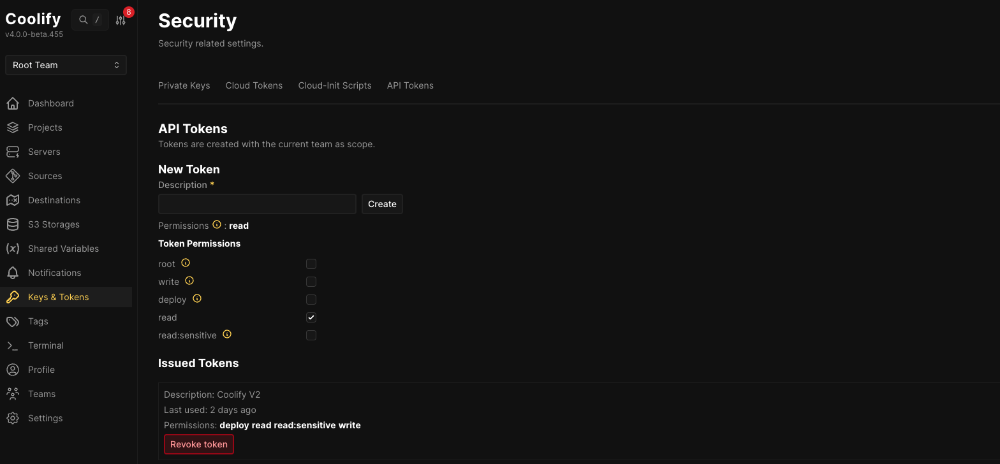

# Coolify Deploy — Claude Code Skill

A [Claude Code skill](https://docs.anthropic.com/en/docs/claude-code/skills) that deploys applications to [Coolify](https://coolify.io) via the GitHub App integration.

## What it does

- Creates Coolify projects
- Adds public or private GitHub repos via GitHub App auth
- Configures subdomains and environment variables
- Triggers deployments

Just tell Claude: _"deploy owner/repo to coolify as myapp.example.com"_ and it handles the rest.

## Installation

Clone into your Claude Code skills directory:

```bash
git clone https://github.com/adamdavies1915/coolify-deploy.git \
  ~/.claude/skills/coolify-deploy
```

## Configuration

### Required

Set your Coolify API token as an environment variable:

```bash
# Coolify v4 tokens use id|hash format — use single quotes to prevent shell interpretation
export COOLIFY_TOKEN='2|G0gaUiI5lG3ryJc3nCoWFrj...'
```

Get a token from your Coolify instance under **Keys & Tokens > API Tokens**:



The bundled script discovers resources, writes configuration, and starts deployments with one token. With dashboard-created tokens, this requires a team-scoped `root` token; a `deploy`-only token cannot perform setup. For deployment-only automation, prefer `deploy`. See [Coolify API permissions](https://coolify.io/docs/api/permissions).

### Customizing for your instance

You can also set `COOLIFY_URL` as an environment variable instead of editing `SKILL.md`:

```bash
export COOLIFY_URL="https://coolify.example.com"
```

## Usage

Once installed, Claude Code will automatically use this skill when you ask it to deploy something to Coolify.

```
> Deploy myorg/api to coolify with subdomain api
> Set up a coolify project for myorg/frontend on port 8080
> Deploy myorg/app to coolify, branch develop, with NODE_ENV=production
```

### Direct script usage

```bash
~/.claude/skills/coolify-deploy/scripts/deploy.sh \
  --repo "owner/repo" \
  --subdomain "myapp" \
  --branch "main" \
  --port 3000
```

Run with `--help` for all options. The script reports when the deployment request is accepted; confirm completion and application health in Coolify before treating the deployment as successful.

## Tests

Run the offline regression checks with Bash and jq installed:

```bash
bash tests/test-deploy.sh
```

The tests replace curl with a local stub and never contact a Coolify instance.

## Prerequisites

- A running [Coolify](https://coolify.io) instance (v4+)
- A GitHub App configured in Coolify for repo access
- A Coolify API token
- `curl` and `jq` installed

## License

MIT
